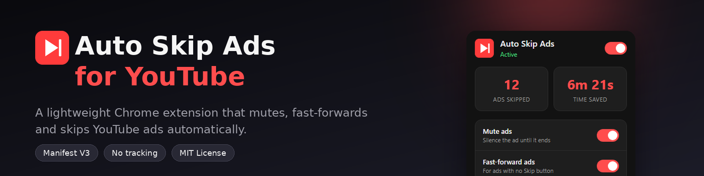
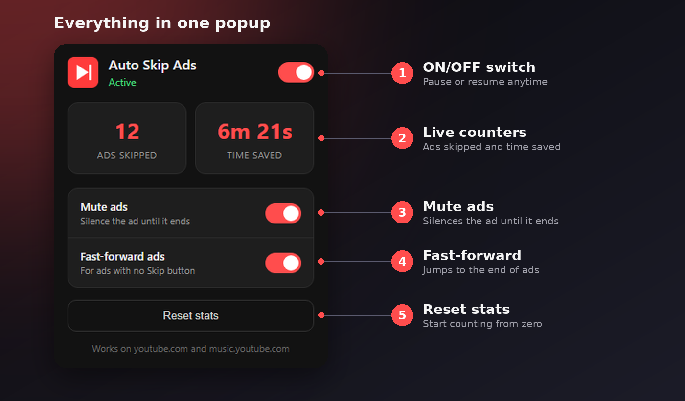
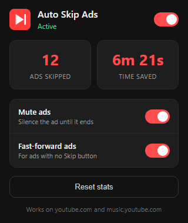

<p align="center">
  
</p>

# Auto Skip Ads for YouTube

> A lightweight Chrome extension (Manifest V3) that automatically skips YouTube ads, so your music and videos keep playing even when you are away from the screen.


## Screenshots

<p align="center">
  
</p>

<p align="center">
  
</p>

## Features

- **Auto-click Skip:** clicks the Skip button the moment it appears
- **Mute ads:** silences the ad while it plays and restores the sound afterwards
- **Fast-forward ads:** jumps to the end of ads that have no Skip button
- **Popup control panel:** ON/OFF switch, settings, and a live counter (ads skipped and time saved)
- **YouTube + YouTube Music:** works on `youtube.com` and `music.youtube.com`
- **Private by design:** no servers, no tracking, no analytics. Settings and stats stay in your browser

## Installation

This extension is not on the Chrome Web Store. Install it in developer mode:

1. **Download** this repository (green **Code** button → **Download ZIP**) and unzip it, or clone it:
   ```bash
   git clone https://github.com/Piyush27080/auto-skip-ads-extension.git
   ```
2. Open `chrome://extensions` (Edge: `edge://extensions`, Brave: `brave://extensions`).
3. Turn on **Developer mode** (top right).
4. Click **Load unpacked** and select the folder that contains `manifest.json`.
5. Open YouTube. Pin the extension from the puzzle icon to open its popup.

> Chrome shows a warning for extensions loaded this way. That is normal for any extension that does not come from the Web Store. Keep Developer mode on or Chrome will disable it.

## Usage

Just watch YouTube. When an ad starts, the extension handles it automatically.

Click the extension icon to:

| Control | What it does |
|---|---|
| **ON/OFF switch** | Pauses or resumes the extension |
| **Mute ads** | Silences the ad until it ends |
| **Fast-forward ads** | Jumps to the end of ads with no Skip button |
| **Reset stats** | Sets the counters back to zero |

## How it works

1. `content.js` is injected into YouTube pages.
2. A `MutationObserver` on the player, video events, and a fast 100 ms backup timer detect the `ad-showing` class the moment it appears.
3. During an ad it runs three steps at once, as fast as possible:
   - **mutes** the video instantly (if enabled),
   - **fast-forwards** at 16x speed instantly and jumps to the end of the ad as soon as its length is known (if enabled),
   - **clicks the Skip button** the moment it is visible.
4. When the ad ends, it restores sound and playback speed and updates the counters.
5. The popup and the content script share settings through `chrome.storage.local`, so changes apply instantly.

## Project structure

```
auto-skip-ads-extension/
├── manifest.json     # Extension config (permissions, popup, content script)
├── content.js        # Runs on YouTube: detects ads, skips, mutes, counts
├── popup.html        # Popup UI
├── popup.css         # Popup styles
├── popup.js          # Popup logic (settings + stats)
├── icons/            # 16, 48 and 128 px icons
├── docs/screenshots/ # Images used in this README
├── CHANGELOG.md
├── CONTRIBUTING.md
├── LICENSE
└── README.md
```

## Privacy

- The only permission requested is `storage`, used to save your settings and counters.
- The extension runs only on `youtube.com` and `music.youtube.com`.
- It makes **no network requests** and sends **no data** anywhere.

## Troubleshooting

- **Nothing happens:** reload the extension on `chrome://extensions`, then refresh the YouTube tab (Ctrl + R).
- Press **F12 → Console**. You should see `[Auto Skip] v2.1 running`, and `Ad detected` when an ad plays.
- **Skip button not clicked:** YouTube changes its page often. Right-click the Skip button → **Inspect**, copy its class name and add it to `SKIP_SELECTORS` in `content.js`.
- **Two ad skippers installed:** disable one, because they can conflict.

## Limitations

- Works in desktop browsers only. Extensions do not run inside the YouTube mobile app.
- YouTube changes its page structure often, so selectors may need updates.

## Roadmap

- [ ] Keyboard shortcut to toggle the extension
- [ ] Daily and weekly stats chart
- [ ] Firefox version
- [ ] Android version using an Accessibility Service

## Disclaimer

This is an **educational project**, not affiliated with, endorsed by, or connected to YouTube or Google. "YouTube" is a trademark of Google LLC. Skipping ads may go against YouTube's Terms of Service. Use it at your own risk and responsibility.

## Contributing

Bug reports and pull requests are welcome. See [CONTRIBUTING.md](CONTRIBUTING.md).

## License

Released under the [MIT License](LICENSE).

## Author

Made by **Piyush**. If this project helped you, consider giving it a ⭐ on GitHub.
